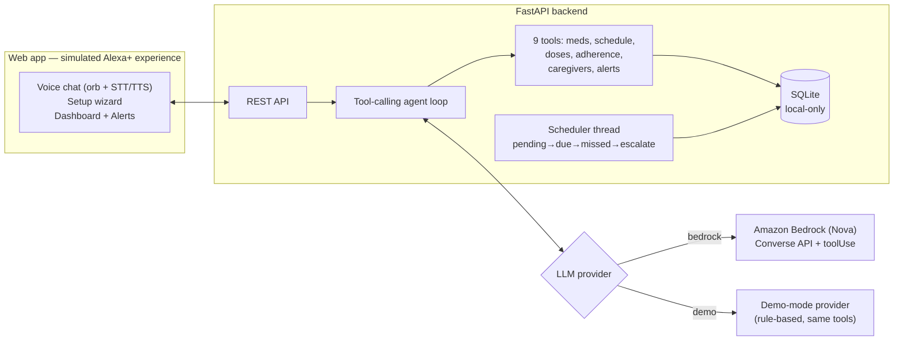

# CareLoop — your family's medication guardian

An **agentic elder-care medication coordinator** built for the
[Build, Ship, Shape: Amazon Developer Hackathon](https://amazonappdev2026.devpost.com/)
**(Alexa+ track)**.

Elderly parents miss doses. Adult children live in other cities. Reminder apps are
dumb alarms with zero follow-through. CareLoop closes the loop: it reminds, listens
for confirmation, **escalates to caregivers when a dose is missed**, and reports
weekly adherence — through a voice-first Alexa+-style experience.

> **Track note:** this project takes the hackathon's explicitly allowed
> *simulated Alexa+ experience* path — a web app built with agentic tooling,
> with all source included and the experience clearly demoed on video.
> The agent backend calls **Amazon Bedrock** (Nova) when AWS credentials are
> present, and otherwise runs a built-in deterministic demo-mode agent that
> drives the exact same tools. The active provider is always reported honestly
> at `GET /api/demo/provider`.

## Demo (2 minutes)

1. **Setup by voice** — "Add Metformin 500mg at 8am and 8pm" → medication card appears.
2. **Reminder fires** — a dose becomes *due*; CareLoop speaks the reminder.
3. **Confirm by voice** — "Yes, taken" → dose recorded, confirmation card.
4. **Missed dose escalates** — no confirmation within the grace period → caregiver
   alert is created and shown in the Alerts tab.
5. **Weekly summary** — "Give me the weekly summary" → adherence card with chart.

## Quickstart

### Backend (Python 3.12, FastAPI)

```bash
cd backend
python3 -m venv .venv && source .venv/bin/activate
pip install -r requirements.txt
cp ../.env.example ../.env   # optional; demo mode needs nothing
uvicorn app.main:app --reload --port 8000
```

### Frontend (React + Vite)

```bash
cd frontend
npm install
npm run dev        # serves on http://localhost:5173
```

Open http://localhost:5173, complete Setup once, then talk to CareLoop in the Chat tab
(voice input uses your browser's Web Speech API; text works everywhere).

### Tests

```bash
cd backend && .venv/bin/python -m pytest -q   # 29 tests
```

## Configuration (`.env`)

| Variable | Default | What it does |
|---|---|---|
| `CARELOOP_LLM_PROVIDER` | `demo` | `bedrock` = Amazon Bedrock (Nova) with real tool calling; `demo` = built-in demo-mode agent (same tools, no cloud) |
| `AWS_REGION` | `us-east-1` | Bedrock region |
| `CARELOOP_BEDROCK_MODEL` | `amazon.nova-lite-v1:0` | Bedrock model ID |
| `CARELOOP_DB_PATH` | `backend/careloop.db` | SQLite file (local-only by design) |
| `CARELOOP_GRACE_MINUTES` | `30` | Minutes before a missed dose escalates |
| `CARELOOP_SNOOZE_MINUTES` | `15` | Snooze re-arm delay |

AWS credentials use the standard chain (`AWS_ACCESS_KEY_ID` / `AWS_SECRET_ACCESS_KEY`
env vars or `~/.aws/`). At startup the backend pings Bedrock once; if unreachable it
**falls back to demo mode loudly** instead of serving a broken chat.

## Architecture



**Key files**

| Path | What it is |
|---|---|
| `backend/app/agent.py` | Provider-agnostic tool-calling loop (stdlib only — extracted as the OSS mini-challenge package) |
| `backend/app/llm.py` | `BedrockProvider` (Converse API + tool calling) and `DemoProvider` |
| `backend/app/careloop_tools.py` | The 9 CareLoop tools + safety system prompt |
| `backend/app/scheduler.py` | Reminder/escalation tick (pure function of `now`, fully tested) |
| `backend/app/db.py` | SQLite storage: patients, caregivers, medications, dose_events, alerts |
| `backend/app/main.py` | FastAPI routes |
| `frontend/` | React + Vite simulated Alexa+ experience |

## API overview

- `POST /api/patients`, `GET /api/patients`
- `POST /api/patients/{id}/caregivers`, `GET /api/patients/{id}/caregivers`
- `POST /api/patients/{id}/medications`, `GET /api/patients/{id}/medications`
- `GET /api/patients/{id}/schedule/today`
- `POST /api/doses/{dose_id}/event` — `{event: taken|missed|snoozed}`
- `POST /api/chat` — `{session_id, message, patient_id}` → `{reply, cards, speak}`
- `GET /api/patients/{id}/adherence?days=7`
- `GET /api/patients/{id}/alerts`, `POST /api/alerts/{id}/acknowledge`
- `POST /api/demo/trigger-due` — demo control: force the next pending dose to *due*
- `GET /api/demo/provider` — honestly reports the active LLM provider

## Hackathon submission notes

- **Primary track:** Alexa+ (simulated experience path, per the official rules).
- **AWS Builder mini challenge:** real Amazon Bedrock integration (`BedrockProvider`
  in `backend/app/llm.py`, Converse API with `toolUse` tool calling, verified with a
  startup ping). Documented here and in `FRICTION_LOG.md`.
- **Open Source mini challenge:** the agent loop (`backend/app/agent.py`) is extracted
  as a standalone MIT-licensed package — see `../miniloop/`.
- **Friction log:** `FRICTION_LOG.md` (up to 10% judging bonus per the rules).

## Safety & privacy

- **Not medical advice.** CareLoop never changes dosages and refuses health-advice
  questions, directing users to their doctor/pharmacist; emergencies → call 112.
- **Local-only data.** Medication data stays in a local SQLite file. No cloud sync,
  no analytics, no tracking.
- Secrets live in `.env`, never in code.

## License

MIT — see [LICENSE](LICENSE).
